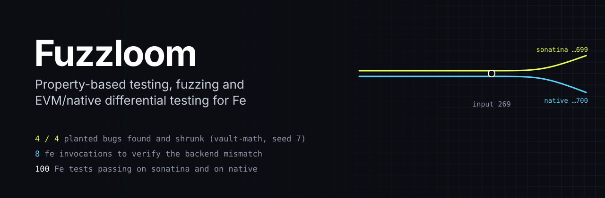
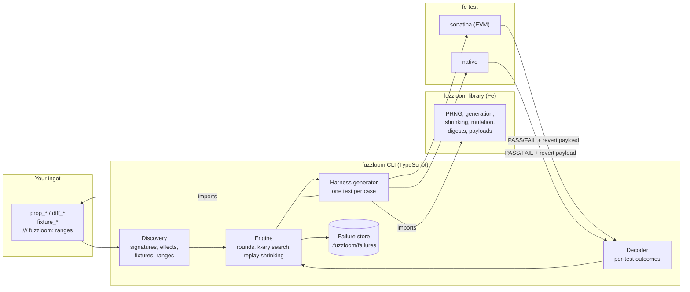

<p align="center">
  
</p>

<p align="center">
  <a href="https://www.npmjs.com/package/fuzzloom"></a>
  <a href="#testing"></a>
  <a href="#quick-start"></a>
  <a href="#quick-start"></a>
  <a href="#testing"></a>
  <a href="#testing"></a>
  <a href="#at-a-glance"></a>
  <a href="#license"></a>
</p>

<p align="center">
  <a href="docs/guide.md"><b>Guide</b></a> ·
  <a href="docs/architecture.md">Architecture</a> ·
  <a href="docs/algorithms.md">Algorithms and guarantees</a> ·
  <a href="examples/vault-math">vault-math example</a> ·
  <a href="examples/token-ledger">token-ledger example</a> ·
  <a href="CHANGELOG.md">Changelog</a> ·
  <a href="CONTRIBUTING.md">Contributing</a>
</p>

---

**Fuzzloom finds the inputs your Fe tests never tried.** You write a property as an ordinary Fe function that returns `bool`. Fuzzloom generates thousands of inputs inside Fe and shrinks every failure to a small counterexample. It saves the failure so you can replay it after the fix. It also runs the same logic on Fe's two backends, **sonatina (EVM)** and **native**, and pins the first input on which they disagree.

```bash
npx fuzzloom doctor    # check fe, the native backend and your project
npx fuzzloom fuzz      # every prop_* function in this ingot, 10,000 inputs each
npx fuzzloom diff      # every diff_* function, sonatina against native
```

## The problem

**Example-based tests check the cases you thought of.** Smart-contract bugs live in the ones you didn't: the top of `u64`, an amount exactly one above a balance, a supply of zero. A test suite of hand-picked inputs passes, and the bug ships.

**Fe compiles one program for two very different machines.** The sonatina backend targets the EVM. The native backend runs the same code as machine code. They are meant to agree on every input, and code is increasingly written to run on both. Nothing checks that they do on the inputs a test suite never tries.

**Fe has no property-based testing tool we could find.** QuickCheck, Hypothesis and proptest serve other languages, and porting one is not enough. On the EVM backend a failure ends the test with a revert, a panic carries no input, and every test is capped at 10^9 gas. A fuzzer for Fe has to be designed around those constraints.

## The solution

```fe
/// A withdrawal is allowed only up to the balance.
pub fn prop_withdraw_never_overdraws(_ balance: u128, _ amount: u128) -> bool {
    !can_withdraw(balance, amount) || amount <= balance
}
```

```text
$ npx fuzzloom fuzz examples/vault-math --seed 7
FAIL  prop_withdraw_never_overdraws(u128, u128)  counterexample at input 19
      balance = 0
      amount  = 1
      shrunk from 216194592332408381925550103855666662331, 216194592332408381925550103855666662332 in 906 evaluations
      reproduce: fuzzloom reproduce prop_withdraw_never_overdraws-2c81bbb3
```

- **The algorithms are written in Fe.** The random generator, the boundary-biased and correlated input generation, the shrinker, the mutation engine and the differential digests are a Fe library ([`ingots/fuzzloom`](ingots/fuzzloom/src)). They run on whichever backend executes the test. The TypeScript CLI discovers targets, writes the test harnesses, runs `fe test`, decodes the results and stores failures.
- **It recovers inputs that Fe cannot report.** Fe cannot catch a panic, so an overflow or a division by zero ends the test with no input in the payload. Fuzzloom's input stream is a pure function of the seed and the iteration. A k-ary search on the run count finds the aborting input exactly, and shrinking by replay makes it small.
- **It understands Fe's effects.** Properties can declare `uses (ledger: mut Ledger, policy: FeePolicy)`. Fuzzloom builds each effect from a `fixture_*()` function in your ingot, fresh for every evaluation, so replay and shrinking stay exact.
- **It compares both backends with very few compiles.** One Fe test emits 256 checkpoint digests from a single pass. The first differing output among 100,000 inputs is pinned in 8 single-test `fe` runs.
- **It refuses to guess.** A compile error, out-of-gas, a timeout or unreadable output is reported as an infrastructure error with exit code 2, never as a failing property or a backend mismatch.

## What it found

### vault-math: four planted bugs, all found and shrunk

[`examples/vault-math`](examples/vault-math) is share accounting for an ERC-4626-style vault with four planted bugs. Every one passes the hand-written tests in the same file. `fuzzloom fuzz --seed 7`, 10,000 inputs per property:

| Property | Planted bug | Found | Shrunk to |
|---|---|---|---|
| `prop_fee_matches_exact_math` | the fee multiplication wraps above `u64::MAX / 30` | input 2 | `614891469123651721`, the exact threshold (`u64::MAX / 30 + 1`) |
| `prop_withdraw_never_overdraws` | `amount <= balance + 1` allows one unit too many | input 19 | `(0, 1)` |
| `prop_redeem_rounds_toward_vault` | redeem rounds up, in favour of the user | input 1 | `(1, 0, 1)`: one share of an empty vault pays 1 |
| `prop_share_price_defined` | no guard for zero supply | aborts at input 13 with `Panic(0x12)` | `(0, 0)`, recovered and shrunk by replay in 6 `fe` runs |

The off-by-one is the instructive one. Its failing inputs lie on the single line `amount == balance + 1`, and two independent 128-bit draws essentially never land on it. Fuzzloom correlates the arguments of one multi-argument draw in eight, which reaches the line. The shrinker's joint move then walks down it to `(0, 1)`.

The example also caught a bug nobody planted. The first version minted shares 1:1 when the supply was zero, and the round-trip property shrank to `(assets 1, total_assets 1, total_supply 0)`. That is the known ERC-4626 first-depositor issue. The model now uses virtual shares, as OpenZeppelin's ERC4626 does.

### A sonatina/native divergence, pinned to one input

`diff_rounding_mode` contains logic gated on `#[cfg(target)]`, which is how backend-specific behaviour slips into shared code. `fuzzloom diff --seed 7` digests every `diff_*` function over 100,000 inputs on both backends:

```text
AGREE   diff_mul_div(u128, u128, u128) -> u256     100000 inputs, identical digests on sonatina and native
AGREE   diff_net_position(i128, i128) -> i128      100000 inputs, identical digests on sonatina and native
AGREE   diff_fee(u64) -> u64                       100000 inputs, identical digests on sonatina and native
DIVERGE diff_rounding_mode(u64) -> u64  first at input 269, found in 3 search rounds, 8 fe runs in total
      x = 15398200176277126999
      sonatina returns 1539820017627712699
      native   returns 1539820017627712700
```

### token-ledger: effects, fixtures and a declared input range

[`examples/token-ledger`](examples/token-ledger) is a two-account token with transfer fees and vesting. The ledger state, the fee policy and the clock all arrive as effects. Two planted bugs:

| Property | Planted bug | Result |
|---|---|---|
| `prop_transfer_conserves_supply` | the minimum fee is not capped at the amount, so tiny transfers underflow | aborts with `Panic(0x11)`, recovered and shrunk to `amount = 0, to_bob = false` |
| `prop_vested_never_exceeds_total` | `total * elapsed` overflows `u128` for grants above about 1.08e31 | aborts at the first input once the property declares `/// fuzzloom: start in 1668464000..=1700000000` |

The vesting bug shows why ranges exist. Without the annotation, a uniform `u64` start almost never falls inside the one-year window before the clock, and 10,000 inputs pass. With it, the first input aborts, and shrinking never leaves the declared range. With both documented fixes applied, `fuzzloom replay` reports both saved failures `FIXED`.

### A crash in the Fe compiler

Building the library hit an internal compiler error, `error[16-0004]`: an `Fn` impl whose effect row is forwarded (`uses E = P::E`), called through a generic `Fn` bound. A minimal reproduction is in [`spike/compiler-bugs/fn-impl-forwarded-effect`](spike/compiler-bugs/fn-impl-forwarded-effect). The library is structured around it. It has not been filed upstream yet.

## At a glance

| | |
|---|---|
| **What it is** | A Fe library of testing algorithms, plus a CLI that turns `prop_*` and `diff_*` functions into `fe test` runs and reads back the results |
| **Who it is for** | Fe developers writing contract logic, math libraries or anything that must behave the same on the EVM and natively |
| **Install** | `npx fuzzloom` (npm, 56 kB, zero runtime dependencies, the Fe library bundled inside) |
| **Inputs** | `u8` to `u256`, `i8` to `i256` and `bool`, 1 to 3 arguments per property, optional per-argument ranges |
| **Finds** | Failing properties, panics and reverts (with the input recovered), and outputs that differ between sonatina and native |
| **Keeps** | Every failure as a JSON record you can reproduce, replay after a fix, and mutate in later campaigns |
| **Reports** | Terminal, `--json`, and JUnit XML (`--junit`) for CI dashboards |
| **Status** | Alpha, built for the Fe Builders Challenge 2026. Verified on fe 26.6.0 on Linux, and on Windows with the native backend through WSL |

## Contents

1. [Quick start](#quick-start)
2. [Writing properties](#writing-properties)
3. [Commands](#commands)
4. [How it works](#how-it-works)
5. [Algorithms and their guarantees](#algorithms-and-their-guarantees)
6. [Differential testing](#differential-testing)
7. [Performance](#performance)
8. [What Fuzzloom does not do](#what-fuzzloom-does-not-do)
9. [Testing](#testing)
10. [Repository layout](#repository-layout)
11. [Status and roadmap](#status-and-roadmap)
12. [Contributing, security and license](#contributing)

## Quick start

You need [fe 26.6](https://fe-lang.org/getting-started/installation/) and Node 22.18 or newer. `diff` and `--backend native` also need fe's native backend, which runs on Linux and macOS. On Windows, Fuzzloom runs it inside WSL automatically.

```bash
cd my-ingot                 # any Fe ingot: a directory with fe.toml and src/
npx fuzzloom doctor         # checks fe, the bundled library, the native backend and your targets
npx fuzzloom fuzz --seed 7  # run every property; the seed makes the run repeatable
```

`doctor` checks everything the first run needs and says how to fix what is missing:

```text
ok    Node              v22.18.0
ok    fe                fe 26.6.0 (5b3f96a) at C:\Users\you\.fe\bin\fe.exe
ok    Fe library        ...\node_modules\fuzzloom\ingot
ok    Library compiles  fe check passed
ok    Native backend    fe 26.6.0 (5b3f96a) in WSL
ok    Project           ingot token_ledger: 4 prop_* and 1 diff_* functions, 0 skipped
```

To work from source instead:

```bash
git clone https://github.com/MikeMoulder/fuzzloom && cd fuzzloom
npm ci
node packages/cli/src/index.ts fuzz examples/vault-math --seed 7
bash scripts/ci.sh          # the whole pipeline: Fe tests on both backends, CLI tests, both demos
```

## Writing properties

Fuzzloom needs no configuration and no import. It discovers public functions by name:

```fe
pub fn prop_<name>(args) -> bool   // a property: must hold for every input
pub fn diff_<name>(args) -> T      // a differential target: must return the same T on both backends
```

| Rule | Detail |
|---|---|
| Arguments | 1 to 3, each `u8`, `u16`, `u32`, `u64`, `u128`, `u256`, `i8` ... `i256` or `bool`; labelled or positional (`_ x`) |
| Return | `bool` for properties; any of the argument types for differential targets |
| Location | anywhere under `src/`, including submodules (imported by their module path) |
| Effects | allowed, when the ingot provides a fixture for each (see below) |
| Anything else | listed by `fuzzloom list` and `doctor` as skipped, with the reason. A typo never silently drops a test |

### Effects and fixtures

Fe makes contract logic testable by passing state and context in as effects. Fuzzloom follows the same pattern. For every effect `T` that a target uses, the ingot provides `pub fn fixture_<anything>() -> T`:

```fe
pub fn prop_transfer_conserves_supply(_ amount: u128, to_bob: bool) -> bool
uses (ledger: mut Ledger, policy: FeePolicy) {
    let before = supply()
    transfer(amount, to_bob)
    supply() == before
}

pub fn fixture_ledger() -> Ledger { Ledger { alice: 1000000, bob: 0, fees: 0 } }
pub fn fixture_policy() -> FeePolicy { FeePolicy { bps: 25, min_fee: 5 } }
```

For a **trait** effect such as `uses (clock: Clock)`, name the fixture after the trait (`fixture_clock`) and return any type that implements it. Each evaluation builds every effect fresh. Evaluations therefore never share state, and a saved failure replays exactly. A target whose effect has no fixture, or more than one, is skipped with that reason.

### Input ranges

A doc-comment line restricts one argument, in that argument's own type:

```fe
/// fuzzloom: start in 1668464000..=1700000000
pub fn prop_vested_never_exceeds_total(_ total: u128, start: u64) -> bool uses (clock: Clock) { ... }
```

`..=` is inclusive and `..` excludes the upper end. The range applies to generation, abort recovery, mutation and differential digests, and shrinking stops at its lower end rather than at zero. Signed words are zigzag-encoded, so a signed range must be centred on zero (`-k..=k` or `-(k+1)..=k`). Any other signed range is rejected with that explanation. A malformed annotation skips the target, so a typo never silently widens a range.

The [guide](docs/guide.md) covers each of these in detail, with the failure messages and how to read them.

## Commands

| Command | What it does |
|---|---|
| `fuzzloom doctor [path]` | Checks Node, fe and its version, that the bundled library compiles with your fe, the native backend, and the project's targets |
| `fuzzloom list [path]` | Lists every target with its signature, effects, fixtures and declared ranges, and every skipped function with the reason |
| `fuzzloom fuzz [path]` | Runs every property campaign, plus one mutation campaign per saved failure, then recovers and shrinks any abort |
| `fuzzloom diff [path]` | Digests every differential target on sonatina and native and pins the first diverging input |
| `fuzzloom reproduce <id> [path]` | Replays one saved failure from its stored input, with no random generation involved |
| `fuzzloom replay [path]` | Replays every saved failure: `FIXED` when it now passes, `FAILS` when it still fails, `REGRESSED` when a fixed failure is back |

| Option | Meaning |
|---|---|
| `--seed <n>` | Base seed. Default: random, printed so the run can be repeated exactly |
| `--runs <n>` | Inputs per property (default 10,000) or per differential target (default 100,000) |
| `--backend <b>` | `sonatina` (EVM, default) or `native` |
| `--only <text>` | Only targets, or saved failures for `replay`, whose name contains the text |
| `--no-corpus` | `fuzz` without the mutation campaigns around saved failures |
| `--json` | Machine-readable output |
| `--junit <file>` | Also write a JUnit XML report: findings are `<failure>`, infrastructure problems are `<error>` |

**Exit codes:** `0` everything passed, `1` a property failed or aborted (or backends diverged), `2` an infrastructure error. Exit code 2 is never a finding.

**Saved failures** live in `.fuzzloom/failures/<target>-<hash>.json`. Each one holds the shrunk and original inputs, the seed, the iteration, the backend and the fe version. Commit them: they are your regression suite. `replay` re-checks all of them, and `fuzz` mutates each one to probe the inputs around it. That catches a fix which only handles the one input that was saved.

## How it works



1. **Discovery** reads your sources, finds `prop_*` and `diff_*` functions, resolves each effect to its fixture and each annotation to a word range. Unsupported functions are reported with the reason.
2. **The engine plans rounds.** Each `fe test` invocation compiles once, then runs all its tests, so the unit of work is a round of independent cases in one generated ingot. All property campaigns go in one round. A differential round runs on sonatina and native at the same time.
3. **The harness generator** writes a throwaway ingot that depends on your ingot and on the Fe library. Each case becomes one `#[test]`, such as `check(prop2(prop_withdraw_never_overdraws), seed: ..., runs: 10000)`. An effectful target is wrapped in a closure that builds its fixtures and provides them with a `with` block.
4. **Results leave Fe as revert payloads.** Every library entry point ends with exactly one ABI-encoded custom error. The CLI splits `fe test` output per test name and decodes each payload by its selector:

| Payload | Selector | Carries |
|---|---|---|
| `Counterexample(seed, iteration, arity, original[3], shrunk[3], shrink_attempts, shrink_complete)` | `0x09fb60c1` | the first failing input and its shrunk form |
| `Passed(seed, runs, arity, edge_args, correlated, extremes)` | `0xf9e5e16c` | what a passing campaign actually exercised |
| `Replayed(arity, input[3], failed)` | `0x8a17327b` | the verdict on one saved input |
| `Generated(seed, iteration, arity, input[3])` | `0x96f7d093` | the input at an iteration, without evaluating it |
| `Digest(seed, runs, arity, acc)` | `0x5389b9fe` | a fold of a target's outputs |
| `Checkpoints(seed, first, step, arity, accs[])` | `0xd79ebb69` | up to 256 prefix digests from one pass |
| `Evaluated(arity, input[3], output)` | `0xa7f6bfeb` | one output, to show how two backends differ |
| `Panic(uint256)`, `Error(string)` | `0x4e487b71`, `0x08c379a0` | an abort from your code |

5. **Anything else is infrastructure.** A compile error, an out-of-gas halt, a timeout, a missing backend, an unknown selector or a truncated payload is classified as such and stays attached to its own test. A test with no result line counts as an error, never as a pass.
6. **Cleanup.** Generated harnesses are deleted when the command ends, so they never appear in your own `fe fmt --check` or `fe test`. After an infrastructure error they are kept, and their path is printed, because the generated code is what you need to debug it.

[docs/architecture.md](docs/architecture.md) goes through each component, the harness format and the outcome classification in full.

## Algorithms and their guarantees

Every non-trivial algorithm states what it guarantees and where it stops, and has a test that would fail if the guarantee broke. Full statements and proofs: [docs/algorithms.md](docs/algorithms.md).

| Algorithm | Where | Guarantee | Limit |
|---|---|---|---|
| **xorshift64\*** PRNG, splitmix64 seed derivation | `rng.fe` | Same seed, same stream on every machine and backend; each property gets an independent stream | Not cryptographic |
| **Range sampling** | `rng.fe` | Uniform over `lo..=hi` by masked rejection sampling, with no modulo bias (tested on a range about 2/3 of 2^256) | At most 2 draws expected, in the worst case |
| **Boundary bias** | `bias.fe` | One argument draw in four comes from the edges: both ends, their neighbours, the midpoint, and `2^k - 1`, `2^k`, `2^k + 1` inside the range | Edges are fixed patterns, not learned |
| **Correlated draws** | `draw.fe` | One multi-argument draw in eight sets argument 1 to argument 0, or one above or below it, with an inverse fallback when widths differ | Only the first two arguments are related |
| **In-Fe shrinking** | `shrink.fe` | Exact sweep of the 256 smallest values, then greedy descent by `2^k`, then joint moves (all to the floor, divide by the gcd or 2, subtract the same `2^k`). When complete, a local minimum under all those moves | Local, not global; 5,000 evaluations by default |
| **Abort recovery** | CLI engine | The first abort is at the same iteration for every run count past it, so k-ary search finds it exactly in at most `ceil(log_(k+1)(runs))` rounds | Needs the property to be deterministic |
| **Shrink by replay** | CLI engine | Every zero, power-of-two shift and joint move of the result is replayed. When complete, none of them reproduces the same abort | Local minimum; 8 rounds by default |
| **Differential digests** | `diff.fe` | An order-sensitive fold, so prefix digests are consistent and "differs at k inputs" is monotone in k | A checksum, not a cryptographic hash |
| **Checkpoints** | `diff.fe` | Element j equals the digest after `first + j * step` inputs exactly, from one pass | 256 checkpoints per payload |
| **Mutation** | `mutate.fe` | Mutants stay within bounds and are prefix-consistent, so an aborting mutation campaign is recovered like any other | Value-level operators; no dictionary of constants from your code |

## Differential testing

A differential target must return the same value on sonatina and native for every input. Fuzzloom checks that without moving 100,000 outputs out of the EVM:

1. Each backend folds its outputs into one 256-bit digest, `acc = (acc ^ out) * FNV_PRIME + FNV_OFFSET` (wrapping), over the same input stream.
2. The first round asks for 256 **checkpoints**: the digest after `k` inputs for 256 evenly spaced values of `k`, ending at 100,000. One test on each backend returns all of them in one pass, and any differing checkpoint proves a divergence.
3. Because the fold is order-sensitive and the stream is deterministic, "the digests differ after k inputs" is false and then true as k grows. A k-ary search over checkpoint rounds narrows 100,000 inputs to one: the first round leaves at most 390 candidates, the second at most 1, and the third settles it.
4. One last round regenerates that input and evaluates it on both backends, so the report shows the input and both outputs.

That is three search rounds of one test per backend plus the recovery round: 8 `fe` runs in total, both backends running at the same time. The search probes are an arithmetic progression, so one checkpoint test can answer a whole round. An abort while digesting is reported as an abort in your code, never as a backend difference.

## Performance

Every `fe test` invocation pays a fixed compile cost, about 2.4 s on an idle machine, plus about 85 ms per extra test. Fuzzloom therefore batches every independent evaluation into one generated ingot. It picks the k-ary search width from that cost model, which gives width 21 for 10,000 runs: 3 rounds instead of the 14 steps of bisection.

Measured on an Intel i7-1185G7 laptop (8 threads, 7 GB, WSL Ubuntu 24.04), fe 26.6.0, seed 7, as run by [`scripts/ci.sh`](scripts/ci.sh):

| Run | Work | Wall time |
|---|---|---|
| `fuzz examples/vault-math` | 7 properties × 10,000 inputs, 4 findings shrunk, 1 abort recovered | 30.7 s |
| `diff examples/vault-math` | 4 targets × 100,000 inputs on both backends, 1 divergence pinned | 13.5 s |
| `fuzz examples/token-ledger` | 4 effectful properties × 10,000 inputs, 2 aborts recovered and shrunk | 69.1 s |
| `diff examples/token-ledger` | 1 effectful target × 100,000 inputs on both backends | 3.2 s |

Batching was measured as an A/B on the same machine under the same load: `fuzz` went from 184 s to 75 s and `diff` from 264 s to 52 s, with identical findings. Checkpoints then cut the divergence search from 12 `fe` runs of up to 21 tests each to 8 runs of one test.

Two Fe-specific limits shape campaign sizes. `fe test` caps each EVM test at 10^9 gas, and the 100,000-input digest of `diff_net_position` fits with room to spare: a digest fits about 290,000 runs. Out-of-gas is reported as an infrastructure error, never as a divergence.

## What Fuzzloom does not do

- **Fuzzing is not a proof.** A passing campaign means 10,000 well-chosen inputs found nothing, and `Passed` reports exactly what was exercised (edge draws, correlated inputs, which argument bounds were reached). It does not mean the property holds for every input.
- **No coverage guidance yet.** Generation is boundary-biased and correlated, and mutation is seeded from saved failures, but nothing steers by which branches ran.
- **No sequences of calls.** Every evaluation gets fresh fixtures by design, which keeps replay exact. A bug that needs a particular sequence of calls is out of scope for now.
- **Integers and bool only, 1 to 3 arguments.** No structs, arrays, addresses or strings as generated inputs yet.
- **Contract-level differential testing is out of scope.** Deploying a contract has no native counterpart, so `diff` compares shared logic, not deployed contracts.
- **Local minima, not global ones.** Both shrinkers state exactly which moves they tried. The vesting example shrinks `total` to about 1.5 times the exact overflow threshold, and the guide shows why.

## Testing

| Suite | Count | What it covers |
|---|---|---|
| Fe library and examples | **92 tests, run on sonatina and on native** | PRNG streams and known answers, unbiased sampling, every generator, every shrink guarantee, prefix consistency, digest and checkpoint exactness, mutation bounds, a known-answer digest recorded identically from both backends |
| CLI | **67 tests** | Discovery (effects, fixtures, ranges, modules), harness generation for every mode, payload decoding, output parsing from real `fe` output, the k-ary search bound swept over every answer position, both replay shrinkers, JUnit, doctor, and integration tests that run real `fe` on both backends |
| Pipeline | [`scripts/ci.sh`](scripts/ci.sh) | Installs Fe, checks formatting, runs both suites, packs the npm package and runs it outside the repo, then asserts that both examples reproduce their documented seed-7 results |

CI runs `scripts/ci.sh` on CircleCI, and the same script runs locally:

```bash
bash scripts/ci.sh
```

## Repository layout

```text
ingots/fuzzloom/          the Fe library: rng, gen, bias, draw, property, shrink, check, mutate, diff, payload
packages/cli/             the TypeScript CLI (published to npm as fuzzloom)
  src/discover.ts         prop_/diff_ discovery, effects, fixtures, ranges
  src/harness.ts          harness generation
  src/engine.ts           rounds, k-ary search, abort recovery, replay shrinking, differential search
  src/fe.ts               running fe test and classifying every outcome
  src/abi.ts              payload decoding (selectors computed with keccak-256, never hardcoded)
examples/vault-math/      pure functions, four planted bugs, four differential targets
examples/token-ledger/    effects, fixtures and a declared range, two planted bugs
spike/                    the experiments that validated each design decision on fe 26.6.0
scripts/ci.sh             the whole CI pipeline
docs/                     guide, architecture, algorithms
```

## Status and roadmap

Fuzzloom is **alpha**, built for the Fe Builders Challenge 2026 and tested hard.

- **Real and tested:** everything above, on fe 26.6.0, on both backends, through CI and through the published npm package.
- **Verified platforms:** Linux; Windows with the native backend through WSL. macOS uses the same code paths as Linux but has not been run by us.
- **Next:** coverage-guided feedback, stateful call sequences, structured inputs (arrays, addresses), campaigns split across tests to go past the gas cap, and filing the compiler crash upstream.

## Contributing

Contributions are welcome. [CONTRIBUTING.md](CONTRIBUTING.md) explains how to run the suites and the one rule that outranks the rest: **a claim needs a test.** A new algorithm states its guarantee and its limit, and comes with a test that fails when the guarantee breaks.

Found a bug in Fuzzloom, or a way it misreports a result? Open an issue. For anything security-sensitive, see [SECURITY.md](SECURITY.md).

## Acknowledgements

- The [Fe](https://github.com/argotorg/fe) team, for a language with effects, a native backend and a test runner worth building on.
- [QuickCheck](https://hackage.haskell.org/package/QuickCheck), [Hypothesis](https://hypothesis.works) and [proptest](https://github.com/proptest-rs/proptest) for property-based testing and shrinking. [AFL](https://lcamtuf.coredump.cx/afl/) and [libFuzzer](https://llvm.org/docs/LibFuzzer.html) for corpus-seeded mutation.
- Sebastiano Vigna, for xorshift64\* and splitmix64.

## License

[Apache License 2.0](LICENSE).
