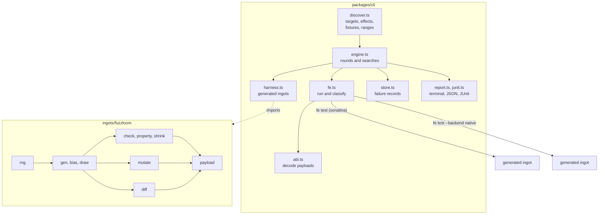

# Architecture

Fuzzloom has two halves with a strict split.

- **The Fe library** ([`ingots/fuzzloom`](../ingots/fuzzloom/src)) holds every testing algorithm: random generation, shrinking, mutation and differential digests. It runs inside `fe test`, on whichever backend executes it.
- **The TypeScript CLI** ([`packages/cli`](../packages/cli/src)) orchestrates. It discovers targets, generates test harnesses, runs `fe`, classifies the output, searches when the library cannot report an input, and stores failures.

The CLI never generates inputs or shrinks anything that Fe can shrink. The only algorithms in TypeScript are the ones that need information Fe cannot hand back: recovering the input of an abort, shrinking by replay, and comparing two backends. Exact guarantees for each algorithm are in [algorithms.md](algorithms.md).



## The Fe library

| Module | Responsibility |
|---|---|
| `rng.fe` | xorshift64\* generator, splitmix64 seed derivation, unbiased bounded sampling |
| `word.fe` | The `Word` trait: every argument type to and from a `u256` word (zigzag for signed) |
| `input.fe` | `Input` (up to three words) and `Bounds` (an inclusive word range per argument) |
| `gen.fe`, `bias.fe` | Uniform ranges and boundary-biased edges |
| `draw.fe` | The campaign input stream: biased per-argument draws plus correlated draws; `generated_at` |
| `property.fe` | `prop1/2/3` wrappers: any callable returning `bool`, its effect row forwarded |
| `shrink.fe` | Sweep, greedy descent and joint moves |
| `check.fe` | Campaigns (`find`, `check`, `check_bounded`), `replay`, `input_at` |
| `mutate.fe` | Mutation campaigns around a saved input: `check_mutating`, `mutant_at`, `mutated_at` |
| `diff.fe` | `Target` and `target1/2/3`; digests, checkpoints, `evaluate`, `target_input_at` |
| `payload.fe` | The `#[error]` structs that carry every result out of Fe |

**Generic over effects.** A property is any `Fn` returning `bool`. The wrappers declare `uses E = F::E`, so a property's effects flow through `check(...)` to the caller, who provides them with `with`. The library therefore never needs to know which effects a user's code has. A generic callable needs `uses F::E` at every level, and the library is written that way throughout.

**Results leave as reverts.** A test function cannot return data to `fe test`, but a revert payload is printed. Every harness entry point (`check`, `replay`, `input_at`, `digest_checkpoints`, `evaluate`, and so on) ends with exactly one `revert_error(...)` of a payload struct. `std::evm::revert_error` works on both backends, and the payload bytes are identical on each; the known-answer digest test checks this.

**Bounded variants.** Each entry point has a `_within` form, or takes `bounds` directly, so a declared input range applies to the campaign, recovery, mutation and digests alike. `target_bounds_of(t)` exists because an associated-function call on a generic type cannot appear in a harness expression in fe 26.6.

## The CLI

### Discovery (`discover.ts`)

Discovery reads every `.fe` file under `src/`, with comments blanked so commented-out code is ignored and line numbers stay right. It matches `pub fn prop_*` and `pub fn diff_*` signatures, including ones that `fe fmt` wrapped across lines. For each match it:

1. parses the parameters and keeps each argument's label: positional (`_ x`), the name, or an explicit label;
2. parses a `uses (...)` clause into effect types;
3. reads `/// fuzzloom: <arg> in <lo>..=<hi>` lines directly above the function into word ranges ([`bounds.ts`](../packages/cli/src/bounds.ts));
4. resolves each effect to exactly one fixture, by return type or else by snake-case name;
5. computes the Fe import paths for the target, its effect types and its fixtures from the file layout (`src/a/b.fe` is `<ingot>::a::b`).

Anything that cannot be tested is returned as skipped, with the reason.

### Harness generation (`harness.ts`)

A harness is a throwaway ingot under `<your ingot>/.fuzzloom/tmp/<label>-<backend>/`. Its dependencies use relative paths, so the same file works for Windows `fe.exe` and for fe inside WSL. Every case becomes one `#[test]`. For the bounded, effectful vesting property in `examples/token-ledger`:

```fe
// Generated by the Fuzzloom CLI. Do not edit.
use fuzzloom::*
use token_ledger::policy::Clock
use token_ledger::policy::fixture_clock
use token_ledger::prop_vested_never_exceeds_total

#[test]
fn case_0() {
    check_bounded(prop2(|a0: u128, a1: u64| {
        var e0 = fixture_clock()
        with (Clock = e0) { prop_vested_never_exceeds_total(a0, start: a1) }
    }), bounds: bounds_of(prop2(|a0: u128, a1: u64| {
        var e0 = fixture_clock()
        with (Clock = e0) { prop_vested_never_exceeds_total(a0, start: a1) }
    })).restrict(1, lo: 0x6372bd80, hi: 0x6553f100), seed: derive_seed(7, 0x5f4a556c0d9d1a2c), runs: 10000)
}
```

The closure is repeated rather than bound to a variable because Fe closures are not `Copy`. A target without effects is passed directly as a function item (`prop2(prop_withdraw_never_overdraws)`).

Harness modes:

| Mode | Fe entry point | Used for |
|---|---|---|
| `check` | `check`, `check_bounded`, `check_mutating(_within)` | A campaign, fresh or around a saved input |
| `replay` | `replay` | One saved or candidate input |
| `input_at` | `input_at`, `mutant_at(_within)` | The input at an iteration, without evaluating it |
| `replay_at` | `replay` of `generated_at` / `mutated_at` | Evaluating that input in the same test |
| `checkpoints` | `digest_checkpoints(_within)` | Up to 256 prefix digests in one pass |
| `target_input_at` | `target_input_at(_within)` | The input a digest drew at an iteration |
| `evaluate`, `evaluate_at` | `evaluate` | One differential output |

### Running fe and classifying (`fe.ts`, `abi.ts`)

`runBatch` runs `fe test --color never [--backend native] <dir>`. On Windows the native backend goes through `wsl -- bash -lc`, with the path translated by `wslpath`. Both backends of a differential round run concurrently. The output is split into one block per `PASS|FAIL [time] name` line, and each block is classified on its own (see [algorithms.md, section 10](algorithms.md#10-classifying-outcomes)). A missing result line is `unparsed`, never a pass. A compile error, which produces no result lines at all, applies to every test in the batch.

Selectors in `abi.ts` are computed with keccak-256 from the signatures, which mirror `payload.fe` field for field. They are never hardcoded, and a test checks them against selectors the Fe compiler actually emitted.

### The engine (`engine.ts`)

The engine thinks in **rounds**. Each `fe test` invocation compiles once, so every evaluation that does not depend on another goes into the same generated ingot.

| Command | Rounds |
|---|---|
| `fuzz` | 1 round: every property's campaign, plus one mutation campaign per saved failure. For each abort: k-ary search rounds on the run count, 1 recovery round (`input_at` + `replay_at`), then shrink-by-replay rounds |
| `diff` | 1 round on each backend at once: 256 checkpoints per target. For each divergence: search rounds of one checkpoint test per backend, then 1 recovery round |
| `replay`, `reproduce` | 1 round per backend that has records, both at once |

Results are combined per target in a fixed order of precedence:
1. the fresh campaign's failure, abort or infrastructure outcome;
2. otherwise, the first mutation campaign that failed, aborted or hit infrastructure;
3. otherwise, a pass.

### Failure records (`store.ts`)

`.fuzzloom/failures/<target>-<fnv8>.json`, version 1. The id is a hash of the target name and the shrunk input, so finding the same minimal failure again updates the record instead of duplicating it.

```json
{
  "version": 1,
  "id": "prop_withdraw_never_overdraws-2c81bbb3",
  "kind": "property",
  "target": "prop_withdraw_never_overdraws",
  "args": [{ "name": "balance", "type": "u128" }, { "name": "amount", "type": "u128" }],
  "input": ["0x0", "0x1"],
  "values": ["0", "1"],
  "original": ["0xa2a5905cfacdaa5f06766da86b098bbb", "0xa2a5905cfacdaa5f06766da86b098bbc"],
  "iteration": "18",
  "base_seed": "7",
  "runs": "10000",
  "backend": "sonatina",
  "fe_version": "fe 26.6.0 (5b3f96a)",
  "status": "open"
}
```

`kind` is `property`, `abort` (with `detail`, the panic reason) or `differential` (backend `both`, with both outputs in `detail`). A record found by a mutation campaign carries `seeded_by`. Records are only ever replayed with their stored input, so they stay valid when the generator changes. `replay` refuses a record whose target changed signature, and says so.

### Reports (`report.ts`, `junit.ts`)

There are three outputs. The terminal output uses colour unless `NO_COLOR` is set or output is not a TTY. `--json` output preserves every field, with bigints as strings. `--junit` writes one test case per property, differential target or saved failure: findings are `<failure>`, infrastructure is `<error>`, and text is escaped, stripped of colour and of characters XML cannot carry.

## Packaging

The npm package `fuzzloom` contains compiled JavaScript (`dist/`), because Node does not strip TypeScript types under `node_modules`. It also contains a copy of the Fe library (`ingot/`), made by the `prepack` script. `libraryIngot()` prefers a repository checkout when running from source, so a stale bundled copy never shadows the live library, and falls back to the bundled copy in an installed package. CI packs the package, installs it into an empty prefix and runs it on a project outside the repo, checking that the bundled library is the one used.

## Constraints that shaped the design

| Constraint (fe 26.6) | Design response |
|---|---|
| A test can only report through a revert payload | Every entry point ends with one ABI-encoded `#[error]`; the CLI decodes by selector |
| Fe cannot catch a panic, so an abort carries no input | A deterministic, prefix-consistent stream, k-ary search on the run count, and shrinking by replay |
| `fe test` compiles once per invocation | Rounds: every independent case in one generated ingot |
| Each EVM test is capped at 10^9 gas | Campaign sizes chosen to fit; out-of-gas is classified as infrastructure, never as a finding |
| The native backend runs on Linux and macOS only | Native runs through WSL on Windows; `doctor` reports its availability |
| `Evm` effects are a type error on native | Differential testing compares shared logic; effects come from user fixtures |
| Fixed-size arrays are not allowed in custom errors | Checkpoints use `DynArray<u256>` built from a `MemVec` |
| Closures are not `Copy` | The harness repeats the closure expression |
| An `Fn` impl with a forwarded effect row, called through a generic bound, crashes the compiler | The library avoids that shape; reproduction in [`spike/compiler-bugs`](../spike/compiler-bugs/fn-impl-forwarded-effect) |
